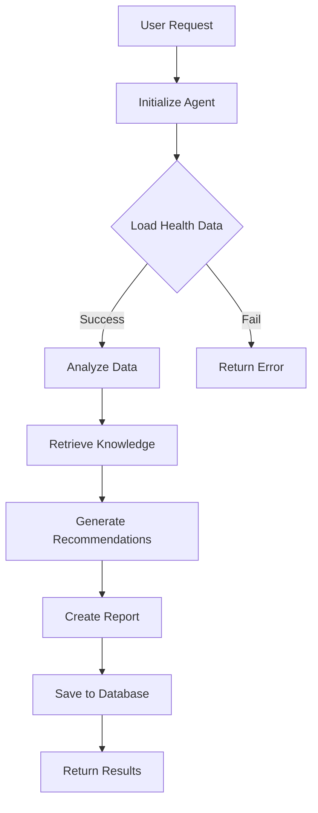

# ARC Health Companion ⚕️

ARC Health Companion uses a LangGraph workflow to process wellness data, retrieve reference material from PostgreSQL with pgvector, and assemble a structured report. The repository includes a command-line interface (CLI). The Quick Start uses the bundled sample data.

See the [workflow diagram](docs/workflow_diagram.png) and [architecture documentation](docs/ARCHITECTURE.md).

## ✨ Features

- **🤖 Agentic AI System**: LangGraph-powered agent with multi-step reasoning
- **📊 Health Data Analysis**: Anomaly detection, trend analysis, and correlations
- **🧠 RAG Pipeline**: pgvector on PostgreSQL vector store with evidence-based health knowledge
- **💡 Personalized Recommendations**: Structured LLM outputs using Instructor
- **💾 Persistent Memory**: PostgreSQL database for user history and adaptation
- **📝 CLI Interface**: Rich terminal interface for power users
- **🔄 Model Clients**: The CLI uses the OpenAI API. The source also includes an Ollama client.

## 🗺️ Architecture

### Agent Workflow



### System Components

- **Interface Layer**: Typer + Rich CLI
- **Agent Layer**: LangGraph multi-step reasoning
- **Storage Layer**: PostgreSQL (user data) + pgvector (embeddings)
- **LLM Layer**: OpenAI GPT-4o-mini by default. An Ollama client is also included.

## 🚀 Quick Start

### Prerequisites

- Python 3.12 and `uv` for the pinned dependencies
- PostgreSQL with pgvector installed and the `psql` client available
- An OpenAI API key for the CLI demo

1. Clone the repository and install the dependencies.

   ```bash
   git clone https://github.com/khaledjamal/health-companion-agent.git
   cd health-companion-agent
   uv venv --python 3.12
   uv pip install -r requirements.txt
   source .venv/bin/activate
   ```

   In Windows PowerShell, activate the environment with `.\.venv\Scripts\Activate.ps1`.

2. Copy the [configuration template](.env.example) to `.env` and set the database connection details and model API key.

   ```bash
   cp .env.example .env
   ```

3. Open `psql` connected to the `postgres` database as a local database administrator. Use the database names and existing login roles from `.env`. This example uses the `admin` role from the template.

   ```sql
   CREATE DATABASE health_companion OWNER admin;
   CREATE DATABASE health_companion_vectors OWNER admin;
   \c health_companion
   CREATE EXTENSION vector;
   \c health_companion_vectors
   CREATE EXTENSION vector;
   SELECT extversion FROM pg_extension WHERE extname = 'vector';
   ```

4. Initialize the databases and load the bundled data. Use demo databases for this step. The `load-knowledge` command replaces the indexed documents in the configured vector store.

   ```bash
   python main.py init-db
   python main.py load-knowledge
   python main.py load-data data/sample_health_data.json
   ```

5. Run the sample analysis. This command calls the configured model API.

   ```bash
   python main.py analyze 2025-10-11 --verbose
   ```

   Use `python main.py report --user-id 1 --days 7` to view recent records. The window ends today. Increase `--days` to include the bundled sample date.

## 📁 Project Structure

```
health-companion-agent/
├── src/
│   ├── agent/              # LangGraph agent implementation
│   │   ├── graph.py        # Agent workflow
│   │   ├── nodes.py        # Node functions
│   │   ├── tools.py        # Agent tools
│   │   └── state.py        # State definition
│   ├── data/               # Data processing
│   │   ├── analyzer.py     # Health analysis
│   │   └── loader.py       # Data loading
│   ├── llm/                # LLM clients
│   │   ├── openai_client.py
│   │   └── ollama_client.py
│   ├── memory/             # Persistence layer
│   │   ├── database.py     # PostgreSQL operations
│   │   └── vector_store.py # pgvector RAG
│   ├── recommendations/    # Recommendation engine
│   │   └── generator.py
│   ├── config.py           # Configuration
│   ├── models.py           # Pydantic models
│   ├── cli.py              # CLI interface
│   └── streamlit_app.py    # Dashboard prototype (not wired up yet)
├── data/
│   ├── sample_health_data.json
│   └── knowledge_base/     # Health knowledge docs
├── tests/                  # Unit tests
├── docs/                   # Documentation
├── examples/               # Sample outputs
├── main.py                 # Entry point
├── requirements.txt
└── README.md
```

## 📊 Usage Examples

### Analyze Health Data

This example uses the bundled sample record dated 2025-10-11. The score shown is an example of the report format.

```python
from src.agent.graph import HealthAgentGraph
from src.memory.database import DatabaseManager
from src.memory.vector_store import VectorStoreManager
from src.llm.openai_client import OpenAIClient
from datetime import date

# Initialize
db = DatabaseManager()
vector_store = VectorStoreManager()
llm = OpenAIClient()
agent = HealthAgentGraph(db, vector_store, llm)

# Run analysis
result = agent.run(user_id=1, target_date=date(2025, 10, 11))

# Access report
report = result["daily_report"]
print(f"Health Score: {report.analysis.overall_score}/100")
```

### Load Custom Data

```python
from src.data.loader import DataLoader
from src.memory.database import DatabaseManager

# Load from JSON
metrics = DataLoader.load_from_json("path/to/data.json")

# Save to database
db = DatabaseManager()
db.save_health_record(metrics)
```

## 🎓 Key Technologies

- **LangGraph**: Agent orchestration and workflow management
- **Instructor**: Structured LLM outputs with Pydantic
- **pgvector on PostgreSQL**: Vector database for RAG
- **SQLModel**: Type-safe database operations
- **Typer + Rich**: Command-line interface
- **OpenAI API**: GPT-4o-mini for reasoning
- **Ollama**: Local model support

## 📝 Data Format

**Health Metrics JSON:**
```json
{
  "date": "2025-10-11",
  "user_id": 1,
  "sleep_hours": 7.5,
  "sleep_quality": 8,
  "hrv": 65,
  "resting_heart_rate": 58,
  "steps": 10000,
  "active_minutes": 45,
  "stress_score": 4,
  "calories_consumed": 2200,
  "water_intake_ml": 2500
}
```

## 🪟 PostgreSQL on Windows Setup

Initialize and start PostgreSQL on Windows:

```bat
REM Initialize data directory
initdb.exe -D "C:\pgdata" -U admin --locale=C --pwfile=C:\temp\pgpass.txt

REM Register as Windows service
pg_ctl.exe register -N postgresql-x64-18 -D "C:\pgdata"

REM Start service
net start postgresql-x64-18
```

After starting the service, connect with `psql -U admin -d postgres` and follow step 3 in the Quick Start.

## 🧩 Testing & Utilities

Create a dedicated `health_companion_test` database before running the tests. The database tests clear tables in that database between cases. Run the full setup utility against the demo databases, where it writes test records and indexes sample documents.

```bash
# Run unit tests
pytest tests/ -v

# Full setup verification
python test_full_setup.py
```

## 🔭 Next Steps

- Finish the Streamlit dashboard prototype (`src/streamlit_app.py`) and connect it to the agent.

## 📄 License

MIT License. See [LICENSE](LICENSE).


